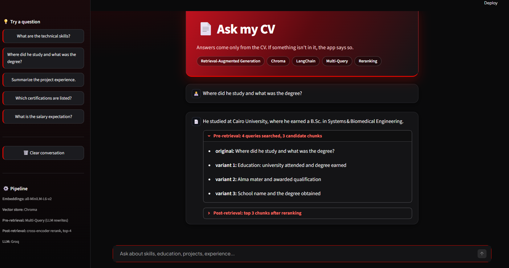
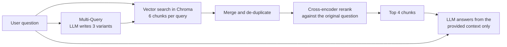
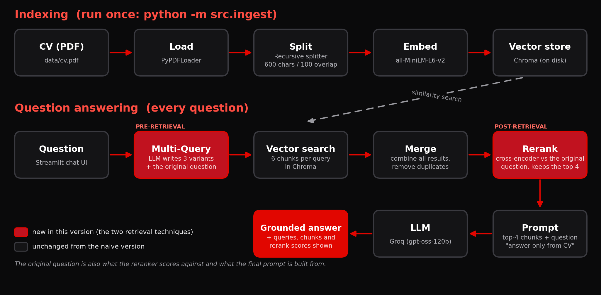

<p align="center">
  
</p>

<p align="center">
  
  
  
  
</p>

<p align="center">
  <a href="https://aligad12.github.io/<your-repo>/"><b>▶ Open the interactive project page</b></a>
</p>

A Retrieval-Augmented Generation (RAG) app that answers questions about my CV. Answers are generated only from retrieved CV content, and when the CV doesn't contain the answer, the app says so instead of inventing one.



## 🔴 Features

- Streamlit chat interface with a red and black theme and conversation history
- **Pre-retrieval:** Multi-Query expansion rewrites each question into several CV-style search queries
- **Post-retrieval:** a local cross-encoder reranks the retrieved chunks and keeps the best 4
- Transparent answers: every answer shows the queries searched and the final chunks, with rerank score and vector distance
- Explicit fallback for questions the CV cannot answer
- Local embeddings and a local reranker (only the LLM needs an API key), plus a persistent vector store

## 🔴 Architecture



1. **Indexing** (once): load the CV PDF, split it into overlapping chunks, embed each chunk, store the vectors in Chroma.
2. **Question answering** (each question):
   1. **Pre-retrieval, Multi-Query:** the LLM rewrites the question into 3 alternative search queries. The original question is always kept too.
   2. **Retrieval:** each query is searched in Chroma (6 chunks per query) and the results are merged without duplicates.
   3. **Post-retrieval, cross-encoder reranking:** every candidate is re-scored against the original question and only the best 4 are kept.
   4. **Generation:** the 4 chunks and the question go into a prompt that restricts the model to the provided context.

The first version was deliberately **naive RAG** (embed the question, take the top-4 chunks), shown below. It is kept in git history under the tag `v1-naive` and as `naive_retrieve()` in `src/rag.py`, so both can be compared with `python -m src.compare`.



## 🔴 Retrieval techniques and why I chose them

**Pre-retrieval: Multi-Query** (`src/query_transform.py`)

- A CV is written in short, keyword-style lines ("Expected Graduation: 2027 | GPA: 3.56/4.0"), while questions are conversational ("When will he graduate?"). One embedding of the question can land closest to the wrong chunk. Several rewrites in CV vocabulary give several chances to hit the right one.
- Broad questions ("summarize the project experience") need several chunks. The variants spread the search across them.
- I chose it over HyDE because HyDE makes the LLM write a fake CV passage, and invented details could steer retrieval. Self-Query and routing do not apply, because the only metadata is the page number.
- The original question is always searched too, and if the LLM call fails the app falls back to it.

**Post-retrieval: cross-encoder reranking** (`src/rerank.py`)

- Multi-Query raises recall but also brings in irrelevant chunks. The reranker restores precision before the prompt is built.
- The embedding model encodes question and chunk separately. A cross-encoder reads them together, which judges relevance better, and it is cheap on the ~10-20 candidates left after Multi-Query.
- I chose a local model over a hosted reranker (Cohere) because it is free, needs no extra API key, and matches the local embeddings. I chose it over contextual compression because compression needs one LLM call per chunk and can drop numbers that matter in a CV.
- It scores against the original question, not the rewrites, so rewrites cannot drift the final selection.

**Cost:** one extra LLM call per question plus a fast CPU pass of the reranker.

**Note:** this CV produces only about 12 chunks, so after merging the queries the pool covers almost the whole CV and the reranker does the real selecting. Both techniques matter more as the knowledge base grows.

## 🔴 Tech stack

| Component | Choice |
|---|---|
| Language | Python 3.10 |
| Orchestration | LangChain |
| PDF loading | PyPDFLoader |
| Chunking | RecursiveCharacterTextSplitter (600 characters, 100 overlap) |
| Embeddings | `sentence-transformers/all-MiniLM-L6-v2` (local) |
| Vector store | Chroma (persisted to `chroma_db/`) |
| Pre-retrieval | Multi-Query expansion (3 LLM-written variants plus the original question) |
| Post-retrieval | Cross-encoder reranking, `cross-encoder/ms-marco-MiniLM-L-6-v2` (local) |
| LLM | Groq API (`openai/gpt-oss-120b`), for query rewriting and answering |
| UI | Streamlit |

## 🔴 Project structure

```
├── app.py                 # Streamlit chat interface (red and black theme)
├── src/
│   ├── loader.py          # load the CV PDF
│   ├── splitter.py        # chunking
│   ├── ingest.py          # embed + store in Chroma
│   ├── query_transform.py # pre-retrieval: Multi-Query
│   ├── rerank.py          # post-retrieval: cross-encoder reranking
│   ├── rag.py             # retrieval pipeline + prompt + LLM
│   ├── compare.py         # naive vs improved retrieval, side by side
│   └── retrieve_test.py   # retrieval-only sanity check (naive)
├── data/cv.pdf            # knowledge base
├── docs/                  # banner, interactive page, diagrams, screenshot
├── .streamlit/config.toml # UI theme
├── .env.example
└── requirements.txt
```

## 🔴 Installation

```bash
git clone <your-repo-url>
cd <your-repo-folder>

python -m venv venv
venv\Scripts\activate          # macOS/Linux: source venv/bin/activate

pip install -r requirements.txt
```

Create a free API key at https://console.groq.com/keys, then:

```bash
copy .env.example .env         # macOS/Linux: cp .env.example .env
```

and set `GROQ_API_KEY` in `.env`. Never commit `.env`.

> **Note:** `data/cv.pdf` is the CV the app answers from. To use a different CV, replace this file and run `python -m src.ingest` again.

## 🔴 Usage

```bash
# 1. Build the vector index (run once, and again whenever the CV changes)
python -m src.ingest

# 2. Start the app
streamlit run app.py

# 3. (optional) Compare naive retrieval with Multi-Query + reranking
python -m src.compare
```

Open http://localhost:8501. The first question is slower because the reranker model (about 90 MB) is downloaded once.

## 🔴 Evaluation

I tested <N> questions across skills, education, experience, projects, certifications, and questions not covered by the CV.

| Category | Result |
|---|---|
| Questions answerable from the CV | <x/y answered correctly> |
| Questions not in the CV | <x/y correctly answered "not found"> |

`python -m src.compare` prints, for each question, the chunks chosen by naive top-4 retrieval and by Multi-Query + reranking, so the effect of the two techniques can be checked directly.

**Observed differences:** <what changed for the questions in src/compare.py>.

## 🔴 Known limitations

- Chunks do not carry their section or project name, so a bullet list can be retrieved without the heading that says which project it belongs to.
- Multi-Query adds one LLM call per question, so answers are slower than in the naive version.
- The reranker model is English-only, and there is no relevance threshold: the app relies on the prompt to say "not found" when the chunks do not contain the answer.
- The CV is small (about 12 chunks), so retrieval tuning has limited room to help.

## 🔴 Troubleshooting

- **Model not found (404):** hosted model names get retired. Check https://console.groq.com/docs/models and update the model name in `src/rag.py` (used for answering and for Multi-Query).
- **`[multi-query] LLM call failed` in the terminal:** usually a Groq rate limit or a retired model. The app keeps working with the original question only, and reranking still applies.
- **Empty or irrelevant answers:** run `python -m src.ingest` again and confirm it reports N chunks with N above 0 (12 for the included CV).
- **Slow first question:** the embedding and reranker models are downloaded on first use.
- **`No module named torchvision`:** `pip install torchvision`.

## 🔴 License

<MIT or your choice>